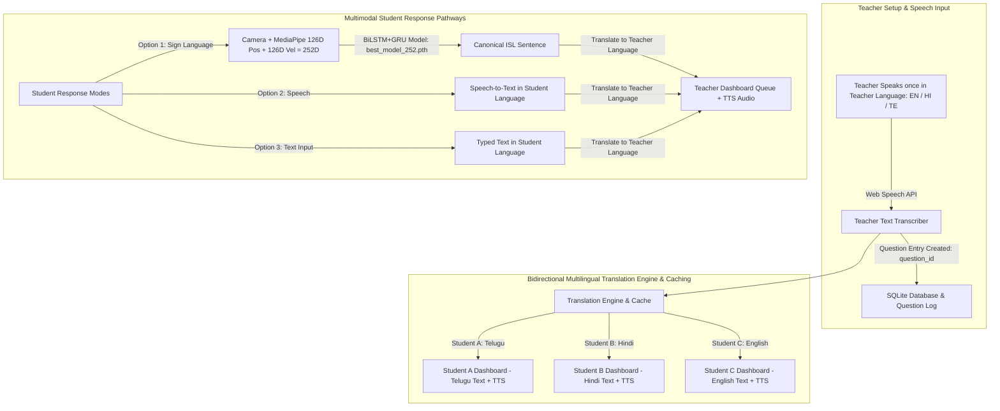

# AI-Powered Multilingual Inclusive Classroom Communication System

[](https://www.python.org/)
[](https://pytorch.org/)
[](https://google.github.io/mediapipe/)
[](https://flask.palletsprojects.com/)
[](LICENSE)

**AI-Powered Multilingual Inclusive Classroom Communication System** is a real-time classroom communication platform designed for **1 Teacher + Multiple Students with different preferred instruction languages**, coupled with **Sign-Language Accessibility** for deaf and non-speaking students.

The system allows a teacher to speak once in their preferred teaching language (**English `en`**, **Hindi `hi`**, or **Telugu `te`**), and automatically translates the instruction in real-time into each student's individual preferred language (e.g. Student A: Telugu, Student B: Hindi, Student C: English). 

For deaf and non-speaking students, the platform preserves the trained 252D BiLSTM+GRU Indian Sign Language (ISL) neural network model (`models/best_model_252.pth`) as an **Accessibility Communication Module** alongside voice speech and text input modes.

---

## 1. Core Architecture & Two-Way Multilingual Flow



---

## 2. Key System Capabilities

### 1. Teacher Language Setup
- Teacher specifies teaching language during classroom creation or on dashboard (**English**, **Hindi**, **Telugu**).
- Teacher speech is transcribed once in Teacher Language and broadcasted without requiring repetition for different student languages.

### 2. Individual Student Language Preferences
- Each student selects their preferred instruction language (**English**, **Hindi**, **Telugu**, **Santhali**, **Ho**, **Mundari**).
- Student screen displays original teacher speech, translated preferred language text, and accessible controls (`[ 🔊 Listen ]`, `[ Original ]`).

### 3. Multimodal Student Response Modes
- **`[ 🤟 Sign Language (Accessibility) ]`**: Neural ISL sign recognition using 252-dimensional landmark vectors (126D position + 126D velocity) mapped to 97 active ISL sentence classes. Canonical English output is translated to Teacher Language with text and `[ 🔊 Play ]` TTS audio.
- **`[ 🎤 Speech ]`**: Student speaks in preferred language; translated to Teacher Language for Teacher Dashboard.
- **`[ ⌨ Text ]`**: Accessible typed text input in student language; translated to Teacher Language.

### 4. Database & Question-Response Linking
- Every teacher statement generates a unique `question_id` (e.g. `q_1788024783082`).
- Student responses across all modes are strictly linked to `question_id` with confidence scores and response mode badges.

### 5. Translation Caching & Offline Fallback
- Sub-millisecond in-memory translation caching (`_SESSION_TRANSLATION_CACHE`) for repeated classroom phrases ($< 0.01 \text{ ms}$).
- Device TTS fallback banner (`"Text available. Voice not available on this device."`) ensures accessible visual text remains clear even if browser audio voice packs are missing.

---

## 3. Directory Structure

```
Combine_model/
├── app.py                            # Main Flask & Socket.IO server endpoints
├── models/
│   ├── best_model_252.pth            # 252D BiLSTM+GRU trained ISL sign neural network
│   ├── label_mapping.json            # 101 class mapping dictionary
│   └── preprocessing_config.json     # Feature pre-processing configuration
├── src/
│   ├── model.py                      # BiLSTM_GRU_Model PyTorch architecture
│   ├── realtime_engine.py            # RealTimeInferenceEngine sequence buffering & inference
│   ├── translation_engine.py         # Vernacular Translation Engine & Cache
│   ├── database.py                   # SQLite classroom database & question log manager
│   ├── audit_and_diagnose.py         # Full system audit diagnostic script
│   └── test_multilingual_system.py   # 14-test verification suite
├── templates/
│   ├── create_room.html              # Teacher room setup with language selection
│   ├── join_room.html                # Student room join with preferred language selection
│   ├── teacher_dashboard.html        # Teacher Dashboard with speech input & student queue
│   └── student_dashboard.html        # High-contrast accessible student dashboard
└── static/                           # CSS styles and frontend assets
```

---

## 4. Verification Suite Results

All 14 integration and system tests passed cleanly:

```bash
python3 src/test_multilingual_system.py
```

```
===========================================================================
=== AI-POWERED MULTILINGUAL INCLUSIVE CLASSROOM SYSTEM VERIFICATION ===
===========================================================================

[TEST 1] Teacher English -> Student Telugu Translation... PASSED
[TEST 2] Teacher English -> Student Hindi Translation... PASSED
[TEST 3] Teacher English -> Student English Pass-through... PASSED
[TEST 4] Multilingual Room: 1 Teacher Speech -> 2 Different Student Languages... PASSED
[TEST 5] Student Sign (Canonical Model Prediction) -> Teacher English... PASSED
[TEST 6] Student Telugu Speech -> Teacher English Translation... PASSED
[TEST 7] Low-Confidence Sign Handling... PASSED
[TEST 8] Translation Caching for Repeated Input (<0.01ms)... PASSED
[TEST 9] Question ID Linking in Database... PASSED
[TEST 10] Multiple Students Answering Same Question... PASSED
[TEST 11] Room Creation & Student Joining with Preferred Language... PASSED
[TEST 12] Session Persistence for Preferred Languages... PASSED
[TEST 13] Translation Fallback when Phrase Unknown... PASSED
[TEST 14] TTS Unavailable Fallback Notice Format... PASSED

===========================================================================
ALL 14 MULTILINGUAL INCLUSIVE CLASSROOM TESTS PASSED SUCCESSFULLY!
===========================================================================
```

---

## 5. Running the Application Locally

```bash
# 1. Install dependencies
pip install -r requirements.txt

# 2. Run system diagnostics audit
python3 src/audit_and_diagnose.py

# 3. Run verification test suite
python3 src/test_multilingual_system.py

# 4. Launch Flask server
python3 app.py
```

Access the application in your browser at `http://localhost:5000`.
