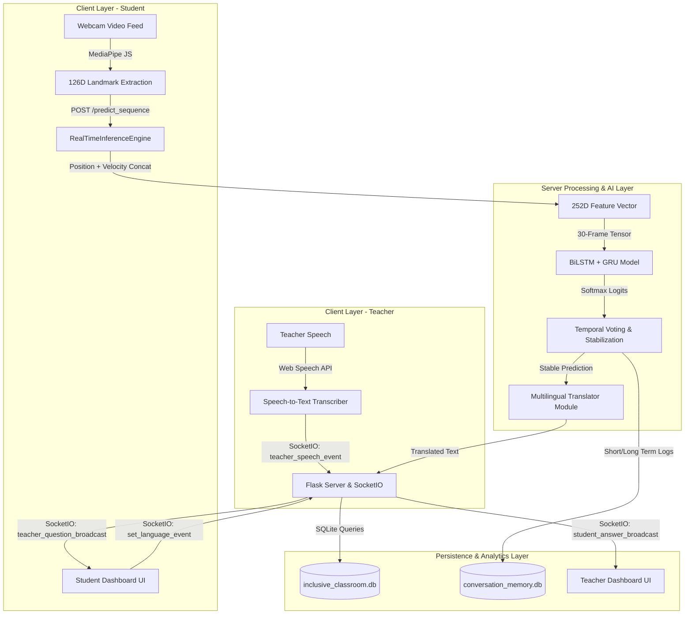

# SIGN-AI — AI-Powered Indian Sign Language Recognition & Inclusive Classroom Platform

[](https://www.python.org/)
[](https://pytorch.org/)
[](https://google.github.io/mediapipe/)
[](https://flask.palletsprojects.com/)
[](LICENSE)

**SIGN-AI** is an artificial intelligence-driven communication and inclusive classroom platform built to bridge the accessibility gap between hearing teachers and students who communicate using Indian Sign Language (ISL). The platform provides continuous, interactive, bi-directional real-time communication within digital virtual classrooms, featuring client-side MediaPipe landmark extraction, a custom 252D BiLSTM+GRU deep learning model, real-time WebSocket synchronization, SQLite classroom persistence, and post-recognition multilingual translation into 8 Indian languages.

---

## 1. Project Overview

In conventional educational settings, students who communicate using Indian Sign Language (ISL) face severe communication barriers due to a lack of real-time sign language interpreters and the inability to instantly convey responses to hearing teachers. **SIGN-AI** creates an inclusive learning environment by providing a seamless, real-time two-way communication bridge:

### Two-Way Classroom Architecture

```
                                  TEACHER TO STUDENT FLOW
┌──────────────────┐    Browser Web Speech API    ┌──────────────────────┐    SocketIO Broadcast    ┌───────────────────┐
│ Teacher Speaks   │ ───────────────────────────► │ Live Text Question   │ ───────────────────────► │ Student Dashboard │
└──────────────────┘                              └──────────────────────┘                          └───────────────────┘
                                                             │
                                                             ▼
                                                Multilingual Translation API
                                            (En -> Te, Hi, Ta, Kn, Ml, Bn, Mr)

                                  STUDENT TO TEACHER FLOW
┌──────────────────┐    MediaPipe JS (Client)     ┌──────────────────────┐    SocketIO / REST       ┌───────────────────┐
│ Student Performs │ ───────────────────────────► │ 252D BiLSTM+GRU Model│ ───────────────────────► │ Teacher Dashboard │
│ ISL Gesture      │    30-Frame Landmarks        │ (Predict / Stabilize)│                          │ & Response Logs   │
└──────────────────┘                              └──────────────────────┘                          └───────────────────┘
                                                             │
                                                             ▼
                                                Multilingual Translation API
                                            (En -> Student Preferred Language)
```

* **Teacher to Student Flow:**
  1. The teacher speaks into their microphone on the Teacher Dashboard.
  2. Spoken instructions are transcribed into text using browser-native Speech Recognition (Web Speech API).
  3. The transcribed question is broadcast in real time to all connected students via Socket.IO.
  4. Each student's dashboard displays the question instantly, automatically translating it into the student's preferred Indian language if configured.

* **Student to Teacher Flow:**
  1. The student captures their ISL gesture via their webcam.
  2. Client-side MediaPipe Hands extracts 3D spatial hand landmarks (21 keypoints per hand, 126 coordinates per frame).
  3. A 30-frame sequence is posted to the backend `/predict_sequence` endpoint, where a **BiLSTM + GRU** neural network evaluates **252D position and velocity features**.
  4. Temporal voting and confidence stabilization algorithms confirm the recognized sentence.
  5. The confirmed prediction is optionally translated into the target language, spoken aloud via Text-to-Speech (TTS), transmitted to the Teacher Dashboard, and stored in the classroom database.

---

## 2. Problem Statement

Students communicating through Indian Sign Language (ISL) experience significant educational friction due to:
* Scarcity of qualified real-time sign language interpreters in general classrooms.
* High latency when attempting to ask or answer questions during fast-paced lectures.
* Communication disconnect between hearing educators and deaf/hard-of-hearing students.

**SIGN-AI** resolves these challenges by integrating:
* **Speech-to-Text Transcription:** Instant visual rendering of teacher lectures for deaf students.
* **Non-Invasive Computer Vision:** Tracks hand gesture trajectories directly from standard webcams without external sensors or hardware gloves.
* **Deep Learning Temporal Sequence Decoding:** Converts 30-frame ISL gesture dynamics into canonical English sentences.
* **Multilingual Post-Recognition Translation:** Translates recognized signs and teacher instructions into regional Indian languages.
* **Real-Time WebSocket Synchronization:** Connects classrooms with zero-latency question-answer workflows.

---

## 3. Main Features

### 👨‍🏫 Teacher Features
* **Virtual Classroom Generation:** Instantly create secure classroom rooms with custom room codes (e.g., `SIGN-XXXX`).
* **Concurrent Multi-Student Support:** Track multiple students connected to a single live room session.
* **Live Speech-to-Text:** Speech recognition converts spoken lectures into readable text.
* **Instruction Broadcasting:** Instant push of questions/instructions to all student screens via Socket.IO.
* **Live Student Status Monitoring:** Real-time visibility into connected students, showing who has answered (`ANSWERED`), who is capturing signs (`CAPTURING_SIGN`), or who is idle.
* **ISL Response Reception:** Receive predicted ISL answers accompanied by model confidence scores and original/translated text.
* **Student Assistance Queue:** Receive and resolve hand-raise help requests from students via `/api/resolve_request`.
* **Classroom Reports & History:** Access exportable summary reports (`/report/<room_code>`) and historical logs (`/history`).

### 👨‍🎓 Student Features
* **Simple Room Access:** Join active sessions using the teacher-provided Room ID and student name.
* **Live Instruction Display:** Receive teacher instructions instantly, translated into the student's selected target language.
* **Client-Side Landmark Extraction:** High-speed MediaPipe landmark tracking running directly in the browser.
* **252D AI Sign Prediction:** Real-time ISL sentence recognition powered by a server-side 252D BiLSTM+GRU model.
* **Prediction Confidence & Stability Badge:** Visual status indicators (`CONFIRMED`, `CAPTURING`, `UNCERTAIN`) backed by temporal voting.
* **Automated & Manual Answer Submission:** Auto-submit confirmed answers when stability thresholds are met or submit manually.
* **Multilingual Interface:** Select from 8 supported Indian languages for real-time translation of questions and recognized signs.
* **Audio Feedback (TTS):** Browser-native SpeechSynthesis audio playback of instructions and recognized signs.
* **Personal Activity History:** Review past classroom interactions, questions, and submitted sign responses.

### 🌐 Multilingual Translation Module
* **8 Supported Languages:** English (`en`), Telugu (`te`), Hindi (`hi`), Tamil (`ta`), Kannada (`kn`), Malayalam (`ml`), Bengali (`bn`), Marathi (`mr`).
* **Multi-Stage Resolution Pipeline:** Session Cache $\rightarrow$ Built-in Offline Canonical Phrase Dictionary $\rightarrow$ Online HTTP Translation Service $\rightarrow$ English Fallback.
* **Zero-Latency Offline Fallback:** Pre-compiled dictionary covering standard classroom instructions and sign dataset phrases.

---

## 4. System Architecture



### Component Responsibilities

* **`app.py`**: Primary Flask application hosting REST endpoints (`/health`, `/predict_sequence`, `/predict`, `/api/translate`, etc.) and Socket.IO events (`join_room_event`, `teacher_speech_event`, `student_answer_event`).
* **`src/realtime_engine.py`**: Singleton engine (`RealTimeInferenceEngine`) managing model loading (`best_model_252.pth`), frame buffer processing, velocity computation, temporal consensus voting, and background TTS queuing.
* **`src/model.py`**: PyTorch neural network definition (`BiLSTM_GRU_Model`) incorporating 1D temporal convolution, BiLSTM, BiGRU, Softmax Temporal Attention, and dual-pooling classification head.
* **`src/multilingual_translator.py`**: Translation engine converting recognized English sentences into 8 Indian languages with caching and offline phrase mapping.
* **`src/database.py`**: SQLite database manager (`ClassroomDatabase`) administering 9 tables in `data/inclusive_classroom.db`.
* **`src/conversation_memory.py`**: Two-layer dialogue memory manager handling short-term prediction smoothing and persistent conversation history.

---

## 5. AI / Machine Learning Model Pipeline

### Feature Extraction & Spatial Normalization

1. **MediaPipe Landmark Detection:** Extracts 21 3D spatial keypoints ($x, y, z$) for both Left and Right hands ($2 \text{ hands} \times 21 \text{ points} \times 3 \text{ coords} = 126 \text{ dimensions}$). Missing hands are zero-padded.
2. **Wrist-Relative Centering:** Hand landmarks are centered relative to their respective wrist landmark ($P_0$):
   $$P_{\text{centered}} = P_i - P_0 \quad \text{for } i \in [0, 20]$$
3. **Palm Scale Normalization:** Coordinates are scaled by the Euclidean distance between the wrist ($P_0$) and middle finger MCP joint ($P_9$):
   $$P_{\text{normalized}} = \frac{P_{\text{centered}}}{\|P_9 - P_0\|_2}$$
4. **Velocity Feature Calculation:** Temporal coordinate change $V[t]$ is computed across consecutive frames:
   $$V[t] = P[t] - P[t-1] \quad \text{for } t > 0, \quad V[0] = \mathbf{0}$$
5. **252D Feature Concatenation:** Position ($126D$) and Velocity ($126D$) are concatenated into a $252D$ vector per frame:
   $$F[t] = \Big[ P_{\text{normalized}}[t] \;\Vert\; V[t] \Big] \in \mathbb{R}^{252}$$

### Neural Network Architecture Breakdown (`BiLSTM_GRU_Model`)

```
Input Sequence: (Batch Size, 30 Frames, 252 Features)
   │
   ├── 1D Temporal Convolution (Conv1d: in=252, out=32, kernel=3, padding=1)
   ├── BatchNorm1d(32) + SiLU Activation + Dropout(0.2)
   │
   ├── Bidirectional LSTM (input=32, hidden=32, layers=1, bidirectional=True)
   ├── LayerNorm(64)
   │
   ├── Bidirectional GRU (input=64, hidden=32, layers=1, bidirectional=True)
   ├── LayerNorm(64)
   │
   ├── Dual-Pooling Branch:
   │    ├── Softmax Temporal Attention Pooling  ──► (Batch, 64)
   │    └── Global Average Pooling              ──► (Batch, 64)
   │
   ├── Concatenation (64 + 64 = 128) + Dropout(0.3)
   │
   ├── Dense Classification Head:
   │    ├── Linear(128 -> 64) + LayerNorm(64) + ReLU + Dropout(0.3)
   │    └── Linear(64 -> 97 Classes)
   │
   └── Logits Output
```

---

## 6. Experimental Benchmark Results

Four comprehensive experimental studies were conducted to systematically evaluate feature representations, multimodal fusion, transfer learning, and multi-branch architectures.

### Experiment 1: Feature Representation Study (`run_velocity_experiments.py`)

Evaluates landmark derivatives to identify the winning feature representation across 97 active ISL sentence classes.

| Model Variant | Feature Representation | Input Shape | Test Accuracy (Top-1) | Top-5 Accuracy | Macro F1 | Val Accuracy | Status |
| :--- | :--- | :--- | :--- | :--- | :--- | :--- | :--- |
| **Model A** | Position Only | $(30, 126)$ | 19.59% | 62.89% | 0.1512 | 22.68% | Baseline |
| **Model B** | **Position + Velocity** | $(30, 252)$ | **36.08%** | **70.10%** | **0.3203** | **31.96%** | **Winning Primary Model** |
| **Model C** | Position + Velocity + Acceleration | $(30, 378)$ | 27.84% | 65.98% | 0.2206 | 31.96% | Degraded |

> **Key Finding:** Concatenating 1st-order velocity ($252D$) improved Top-1 test accuracy from 19.59% to **36.08%** (+16.49%). Adding 2nd-order acceleration ($378D$) introduced high-frequency noise from discrete frame differentiation, causing performance degradation.

---

### Experiment 2: Hand-Crop Gated Multimodal Study (`run_hand_crop_experiments.py`)

Evaluates combining landmark motion vectors with MobileNetV3 visual features extracted from cropped RGB hand regions.

| Architecture Variant | Modal Inputs | Top-1 Test Acc | Top-5 Test Acc | Macro F1 | Inference Latency |
| :--- | :--- | :--- | :--- | :--- | :--- |
| **Exp A: Motion Baseline** | 252D Motion Vector | 9.28% | 35.05% | 0.0643 | **0.39 ms** |
| **Exp B: Visual Crops Only** | MobileNetV3 Hand Crops | 1.03% | 4.12% | 0.0007 | 0.10 ms |
| **Exp C: Gated Multimodal** | Motion + Visual Hand Crops | **14.43%** | **43.30%** | **0.0943** | 0.58 ms |

> **Key Finding:** Learnable Gated Fusion (Exp C) yields higher top-1 and top-5 accuracy on RGB crop benchmarks, but MobileNetV3 visual feature extraction adds computational overhead, making 252D landmark motion preferred for high-speed real-time browser execution.

---

### Experiment 3: Transfer Learning Study (`run_transfer_learning_experiments.py`)

Evaluates ImageNet default pre-training versus domain-specific word-level fine-tuning on ISL hand crops (`word_pretrain.py`).

| Pre-training Strategy | Top-1 Test Acc | Top-5 Test Acc | Macro F1 | Winning Architecture |
| :--- | :--- | :--- | :--- | :--- |
| **Exp A: Default ImageNet CNN** | 9.28% | 32.99% | 0.0711 | Baseline |
| **Exp B: ISL Word-Pretrained CNN** | **19.59%** | **49.48%** | **0.1570** | **Winning Strategy** |

---

### Experiment 4: 3-Branch Modality Fusion Study (`run_3branch_fusion_experiments.py`)

Evaluates multi-modality fusion combining Hand Motion (252D), Facial Features (16D), and Upper-Body Pose Landmarks (24D).

| Fusion Variant | Modal Branches | Top-1 Test Acc | Top-5 Test Acc | Macro F1 | Winning Architecture |
| :--- | :--- | :--- | :--- | :--- | :--- |
| **Exp A: Hand Only** | 252D Hand Motion | **9.28%** | **23.71%** | **0.0524** | **Winning Architecture** |
| **Exp B: Hand + Face** | Hand (252D) + Face (16D) | 4.12% | 13.40% | 0.0309 | Degraded |
| **Exp C: Hand + Pose** | Hand (252D) + Pose (24D) | 4.12% | 19.59% | 0.0265 | Degraded |
| **Exp D: Hand + Face + Pose** | Hand (252D) + Face (16D) + Pose (24D) | 6.19% | 22.68% | 0.0301 | Degraded |

> **Key Finding:** In the ISL-CSLRT dataset, facial and upper-body pose keypoints contained tracking noise and low variance across sentence classes. Isolating the Hand Motion branch yielded superior classification metrics.

---

## 7. Dataset & Preprocessing

### Dataset Audit (`src/dataset_audit.py`)

The ISL-CSLRT sentence-level video corpus was processed and audited to verify dataset integrity:

* **Total Recovered Sequences:** 673 clean video sequence samples.
* **Active Classes:** 97 distinct ISL sentence classes (classes with $\ge 5$ verified samples retained).
* **Excluded Classes:** 4 low-sample classes ($< 5$ samples) documented in `data/excluded_low_sample_classes.json`.
* **Sequence Uniform Dimensions:** 30 frames per sequence $\times$ 126 raw landmark dimensions (`data/x_features.npy`).

### Verified Dataset Split Statistics (`results/dataset_audit_report.json`)

```
Total Dataset: 673 Samples (97 Active Classes)
   ├── Training Split   : 479 Samples (71.17%) — Data Augmentation Applied
   ├── Validation Split :  97 Samples (14.41%) — Pristine / Unaugmented
   └── Test Split       :  97 Samples (14.41%) — Pristine / Unaugmented
```

> **Data Leakage Verification:** Verified 100% disjoint sample indices across Train, Validation, and Test sets. Data augmentation (Gaussian noise $\sigma=0.008$, random scaling $0.95\text{--}1.05$, random frame dropout 10%) was applied **strictly to the training set**.

---

## 8. Database & Memory Architecture

### SQLite Classroom Database (`data/inclusive_classroom.db`)

Managed by `ClassroomDatabase` in `src/database.py`, providing persistence across 9 tables:

```sql
-- 1. Virtual Classrooms
CREATE TABLE rooms (
    room_code TEXT PRIMARY KEY,
    teacher_name TEXT NOT NULL,
    room_name TEXT NOT NULL,
    subject TEXT NOT NULL,
    description TEXT,
    max_students INTEGER DEFAULT 30,
    password TEXT,
    created_at TEXT NOT NULL,
    status TEXT DEFAULT 'active'
);

-- 2. Room Members & Language Preference
CREATE TABLE room_members (
    id INTEGER PRIMARY KEY AUTOINCREMENT,
    room_code TEXT NOT NULL,
    student_name TEXT NOT NULL,
    status TEXT DEFAULT 'online',
    preferred_language TEXT DEFAULT 'en',
    joined_at TEXT NOT NULL,
    FOREIGN KEY (room_code) REFERENCES rooms (room_code)
);

-- 3. Class Sessions
CREATE TABLE class_sessions (
    id INTEGER PRIMARY KEY AUTOINCREMENT,
    room_code TEXT NOT NULL,
    session_start TEXT NOT NULL,
    session_end TEXT,
    attendance_count INTEGER DEFAULT 0,
    FOREIGN KEY (room_code) REFERENCES rooms (room_code)
);

-- 4. Teacher Messages
CREATE TABLE teacher_messages (
    id INTEGER PRIMARY KEY AUTOINCREMENT,
    room_code TEXT NOT NULL,
    message_text TEXT NOT NULL,
    timestamp TEXT NOT NULL,
    FOREIGN KEY (room_code) REFERENCES rooms (room_code)
);

-- 5. Student Sign Detection Logs
CREATE TABLE student_sign_logs (
    id INTEGER PRIMARY KEY AUTOINCREMENT,
    room_code TEXT NOT NULL,
    student_name TEXT NOT NULL,
    detected_sentence TEXT NOT NULL,
    confidence REAL NOT NULL,
    status TEXT NOT NULL,
    timestamp TEXT NOT NULL,
    FOREIGN KEY (room_code) REFERENCES rooms (room_code)
);

-- 6. Student Request Queue (Hand Raise Help Requests)
CREATE TABLE student_requests (
    id INTEGER PRIMARY KEY AUTOINCREMENT,
    room_code TEXT NOT NULL,
    student_name TEXT NOT NULL,
    detected_sentence TEXT NOT NULL,
    confidence REAL NOT NULL,
    status TEXT DEFAULT 'pending',
    timestamp TEXT NOT NULL,
    FOREIGN KEY (room_code) REFERENCES rooms (room_code)
);

-- 7. Broadcast Questions
CREATE TABLE questions (
    question_id TEXT PRIMARY KEY,
    room_code TEXT NOT NULL,
    teacher_name TEXT NOT NULL,
    question_text TEXT NOT NULL,
    created_at TEXT NOT NULL,
    FOREIGN KEY (room_code) REFERENCES rooms (room_code)
);

-- 8. Student Responses (Linked to Question ID)
CREATE TABLE student_responses (
    id INTEGER PRIMARY KEY AUTOINCREMENT,
    question_id TEXT NOT NULL,
    room_code TEXT NOT NULL,
    student_name TEXT NOT NULL,
    predicted_answer TEXT NOT NULL,
    confidence REAL NOT NULL,
    status TEXT DEFAULT 'ANSWERED',
    created_at TEXT NOT NULL,
    updated_at TEXT NOT NULL,
    FOREIGN KEY (question_id) REFERENCES questions (question_id),
    FOREIGN KEY (room_code) REFERENCES rooms (room_code)
);

-- 9. Student Activity Audit Logs
CREATE TABLE student_activity_logs (
    id INTEGER PRIMARY KEY AUTOINCREMENT,
    student_name TEXT NOT NULL,
    room_code TEXT NOT NULL,
    question_id TEXT,
    action_type TEXT NOT NULL,
    message TEXT NOT NULL,
    confidence REAL DEFAULT 0.0,
    timestamp TEXT NOT NULL
);
```

### Conversation & Dialogue Memory (`data/conversation_memory.db`)

Managed by `src/conversation_memory.py`:
* **Layer 1 (ShortTermPredictionMemory):** Rolling prediction buffer (size 7) performing temporal voting, confidence thresholding ($\ge 35\%$), and probability margin verification ($\ge 8\%$).
* **Layer 2 (ConversationMemoryStore):** Persistent SQLite store (`conversation_history` table: `id`, `sender`, `message`, `timestamp`, `confidence`) preserving two-way dialogue turns.

---

## 9. Real-Time WebSocket Communication

Real-time bidirectional synchronization is powered by **Flask-SocketIO** running over **eventlet**.

| Socket.IO Event Name | Direction | Payload Parameters | Trigger / Purpose |
| :--- | :--- | :--- | :--- |
| `join_room_event` | Client $\rightarrow$ Server | `room_code`, `user_name`, `role`, `preferred_language` | User joins room session; triggers `student_joined_event` broadcast |
| `teacher_speech_event` | Client $\rightarrow$ Server | `room_code`, `teacher_name`, `message` | Teacher broadcasts question; saves in DB, triggers `teacher_question_broadcast` |
| `student_answer_event` | Client $\rightarrow$ Server | `question_id`, `room_code`, `student_name`, `original_prediction`, `target_language`, `confidence` | Student submits ISL sign answer; updates DB, triggers `student_answer_broadcast` |
| `set_language_event` | Client $\rightarrow$ Server | `room_code`, `student_name`, `target_language` | Updates student's preferred language in database |
| `student_status_event` | Client $\rightarrow$ Server | `room_code`, `student_name`, `status` | Broadcasts student status updates (`CAPTURING_SIGN`, `TYPING`, etc.) |

---

## 10. Complete REST API Documentation

### System & Health Endpoints

#### 1. Health Check
* **Method:** `GET`
* **Endpoint:** `/health`
* **Purpose:** Returns service operation status and model load state.
* **Response (200 OK):**
  ```json
  {
    "status": "ok",
    "service": "sign-ai",
    "model_loaded": true
  }
  ```

---

### Real-Time Sign Recognition Endpoints

#### 2. Sequence Prediction (Primary Browser Endpoint)
* **Method:** `POST`
* **Endpoint:** `/predict_sequence`
* **Purpose:** Receives pre-extracted 30-frame $\times$ 126-feature landmark array from client-side MediaPipe, computes 252D velocity features, and returns prediction.
* **Request Body (JSON):**
  ```json
  {
    "sequence": [
      [0.012, -0.45, 0.12, "...", 126 values],
      "... 30 frames total ..."
    ]
  }
  ```
* **Response (200 OK):**
  ```json
  {
    "status": "success",
    "predicted_text": "i am sitting in the class",
    "confidence": 82.34,
    "top_predictions": [
      {"sentence": "i am sitting in the class", "confidence": 82.34},
      {"sentence": "what are you doing", "confidence": 8.12}
    ],
    "stable": true,
    "uncertain": false,
    "signer_status": "Frontend MediaPipe",
    "model_loaded": "best_model_252.pth"
  }
  ```
* **Error Responses:** `400 Bad Request` (invalid array shape/length), `500 Internal Server Error`.

#### 3. Base64 Image Prediction (Fallback Endpoint)
* **Method:** `POST`
* **Endpoint:** `/predict`
* **Purpose:** Receives single base64-encoded image frame, extracts landmarks server-side, appends to buffer, and returns prediction.
* **Request Body (JSON):**
  ```json
  {
    "image": "data:image/jpeg;base64,/9j/4AAQSkZJRg..."
  }
  ```

---

### Classroom & Question Management Endpoints

#### 4. Create Room
* **Method:** `POST`
* **Endpoint:** `/api/create_room`
* **Request (Form Data):** `teacher_name`, `room_name`, `subject`, `description`, `max_students`, `password`
* **Response:** `302 Redirect` to `/teacher/<room_code>`

#### 5. Join Room
* **Method:** `POST`
* **Endpoint:** `/api/join_room`
* **Request (Form Data):** `student_name`, `room_code`, `password`
* **Response:** `302 Redirect` to `/student/<room_code>`

#### 6. Fetch Latest Question
* **Method:** `GET`
* **Endpoint:** `/api/latest_question/<room_code>`
* **Response (200 OK):**
  ```json
  {
    "question_id": "Q-8A91F",
    "room_code": "SIGN-4012",
    "teacher_name": "Prof. Sharma",
    "question_text": "please open your notebook",
    "created_at": "2026-08-29 10:15:00"
  }
  ```

#### 7. Fetch Question Responses
* **Method:** `GET`
* **Endpoint:** `/api/question_responses/<question_id>`
* **Response (200 OK):**
  ```json
  {
    "responses": [
      {
        "student_name": "Rahul",
        "predicted_answer": "i am sitting in the class",
        "confidence": 85.5,
        "status": "ANSWERED",
        "timestamp": "2026-08-29 10:16:12"
      }
    ]
  }
  ```

#### 8. Student Activity Logs
* **Method:** `GET`
* **Endpoint:** `/api/student_activity/<room_code>/<student_name>`
* **Response (200 OK):** Returns array of activity log records for specified student.

#### 9. Resolve Student Request
* **Method:** `POST`
* **Endpoint:** `/api/resolve_request`
* **Request Body (JSON):** `{"request_id": 14}`
* **Response (200 OK):** `{"status": "success"}`

---

### Multilingual Translation Endpoints

#### 10. Get Supported Languages
* **Method:** `GET`
* **Endpoint:** `/api/languages`
* **Response (200 OK):**
  ```json
  {
    "status": "success",
    "default_language": "en",
    "languages": {
      "en": {"name": "English", "native": "English", "bcp47": "en-US"},
      "te": {"name": "Telugu", "native": "తెలుగు", "bcp47": "te-IN"},
      "hi": {"name": "Hindi", "native": "हिन्दी", "bcp47": "hi-IN"},
      "ta": {"name": "Tamil", "native": "தமிழ்", "bcp47": "ta-IN"},
      "kn": {"name": "Kannada", "native": "ಕನ್ನಡ", "bcp47": "kn-IN"},
      "ml": {"name": "Malayalam", "native": "മലയാളം", "bcp47": "ml-IN"},
      "bn": {"name": "Bengali", "native": "বাংলা", "bcp47": "bn-IN"},
      "mr": {"name": "Marathi", "native": "మరాఠీ", "bcp47": "mr-IN"}
    }
  }
  ```

#### 11. Translate Text
* **Method:** `POST`
* **Endpoint:** `/api/translate`
* **Request Body (JSON):**
  ```json
  {
    "text": "i need water",
    "target_language": "te"
  }
  ```
* **Response (200 OK):**
  ```json
  {
    "source_text": "i need water",
    "target_language": "te",
    "translated_text": "నాకు నీళ్లు కావాలి",
    "status": "success"
  }
  ```

---

## 11. Project Structure

```
SIGN-AI/
├── app.py                             # Main Flask application with REST & SocketIO routes
├── requirements.txt                   # Production runtime dependencies
├── Procfile                           # Heroku / Web PaaS startup command (web: python app.py)
├── render.yaml                        # Render cloud deployment specification (Python 3.10.12)
├── .python-version                    # Python runtime pin (3.10.12)
├── .env.example                       # Template for environment configuration
├── README.md                          # Comprehensive project documentation
│
├── src/                               # Core Python source modules
│   ├── config.py                      # Paths, model hyperparameters, normalization functions
│   ├── database.py                    # SQLite Database Manager (9 classroom tables)
│   ├── model.py                       # 252D BiLSTM + GRU model with Temporal Attention
│   ├── realtime_engine.py             # Inference engine, temporal voting, TTS queue worker
│   ├── multilingual_translator.py     # 8-language post-recognition translation service
│   ├── conversation_memory.py         # Short-term buffer & long-term conversation store
│   ├── feature_extraction.py          # MediaPipe extraction & landmark normalization
│   ├── geometric_features.py          # Additional spatial geometric feature utilities
│   ├── hand_crop_extractor.py         # MobileNetV3 CNN encoder for RGB hand crops
│   ├── image_enhancer.py              # Low-light adaptive enhancement (CLAHE + Gamma)
│   ├── modality_gated_model.py        # 3-Branch Modality Gated Fusion model definition
│   ├── multimodal_gated_model.py      # Two-branch Motion + Visual Gated model definition
│   ├── multimodal_model.py            # Early fusion multimodal landmark + RGB model
│   ├── tts_engine.py                  # Offline Text-To-Speech wrapper
│   ├── video_inference.py             # Offline video file inference pipeline
│   ├── webcam_inference.py            # Local desktop webcam test utility
│   ├── word_pretrain.py               # Pre-training script for MobileNetV3 on word crops
│   ├── dataset_audit.py               # Dataset verification & split audit script
│   ├── dataset_verification.py        # Video corruption & trackability auditor
│   ├── build_final_97_dataset.py      # Dataset compiler for 97 active classes
│   ├── rebuild_features_97.py         # Feature rebuild script for 97 classes
│   ├── train.py                       # Main training script for 252D BiLSTM+GRU
│   ├── train_multimodal.py            # Training script for multimodal gated models
│   ├── train_word_level_cnn.py        # Training script for word-level CNN encoder
│   ├── run_velocity_experiments.py    # Experiment runner: 126D vs 252D vs 378D
│   ├── run_hand_crop_experiments.py   # Experiment runner: Motion vs Hand Crops vs Gated
│   ├── run_transfer_learning_experiments.py # Experiment runner: ImageNet vs Word-Pretrained
│   ├── run_3branch_fusion_experiments.py    # Experiment runner: Hand vs Face vs Pose
│   └── run_all_experiments.py         # Unified benchmark runner across all models
│
├── models/                            # Trained weights & metadata artifacts
│   ├── best_model_252.pth             # Winning 252D BiLSTM + GRU trained weights (Primary)
│   ├── best_model_126.pth             # Baseline 126D model weights
│   ├── best_model_378.pth             # Acceleration 378D model weights
│   ├── bilstm_gru_model.pth           # Final epoch model state checkpoint
│   ├── label_mapping.json             # Index-to-label mapping for 97 ISL sentence classes
│   ├── eval_metrics.json              # Baseline evaluation metrics report
│   ├── velocity_experiment_metrics.json # 126D vs 252D vs 378D benchmark metrics
│   ├── multimodal_metrics.json        # Multimodal experimental evaluation metrics
│   ├── training_history.png           # Training vs validation loss/accuracy chart
│   └── confusion_matrix.png           # Test set confusion matrix visualization
│
├── data/                              # Data storage & SQLite databases
│   ├── inclusive_classroom.db         # Active SQLite classroom database (9 tables)
│   ├── conversation_memory.db         # Persistent dialogue history database
│   ├── x_features.npy                 # Processed landmark features array (673, 30, 126)
│   ├── y_labels.npy                   # Processed target class indices array (673,)
│   ├── x_features_all.npy             # Complete unfiltered landmark features array
│   ├── x_hand_features_252.npy        # Pre-computed 252D position+velocity features
│   ├── multimodal_manifest.csv        # Dataset manifest linking videos, frames, and labels
│   ├── dataset_video_status.csv       # Status tracking CSV for video processing
│   ├── excluded_low_sample_classes.json # Record of 4 excluded classes (< 5 samples)
│   └── extraction_progress.json       # Feature extraction checkpoint file
│
├── static/                            # Static frontend web assets
│   ├── css/
│   │   └── classroom.css              # Custom responsive stylesheet for classroom views
│   ├── script.js                      # Main client JavaScript logic
│   ├── style.css                      # Base application stylesheet
│   └── uploads/                       # Temporary upload storage directory
│
├── templates/                         # Jinja2 HTML View Templates
│   ├── index.html                     # Platform landing page
│   ├── create_room.html               # Teacher room creation view
│   ├── join_room.html                 # Student room join view
│   ├── teacher_dashboard.html         # Live teacher management dashboard
│   ├── student_dashboard.html         # Live student sign interaction dashboard
│   ├── history.html                   # Session history & activity log viewer
│   └── report.html                    # Detailed classroom session report page
│
├── results/                           # Experimental outputs, benchmark logs & plots
│   ├── dataset_audit_report.json      # Dataset audit JSON report
│   ├── controlled_experiments_metrics.json # Controlled baseline comparison metrics
│   ├── hand_crop_experiments_metrics.json  # Hand-crop multimodal benchmark metrics
│   ├── transfer_learning_experiments_metrics.json # Transfer learning benchmark metrics
│   ├── 3branch_fusion_metrics.json    # Multi-branch fusion benchmark metrics
│   └── velocity_experiment_comparison.png  # Feature representation comparison chart
│
└── ISL_CSLRT_Corpus/                  # Raw ISL Sentence & Word video dataset files
```

---

## 12. Installation & Setup

### Prerequisites

* **Operating System:** macOS, Linux, or Windows.
* **Python Runtime:** **Python 3.10.12** (pinned via `.python-version` and `render.yaml`; `mediapipe==0.10.21` requires Python 3.10).
* **Web Browser:** Modern WebRTC-compliant browser (Chrome, Edge, Firefox, Safari) with webcam permissions enabled.

### Step 1: Clone Repository
```bash
git clone https://github.com/Gireesh169/SIGN_AI.git
cd Combine_model
```

### Step 2: Create & Activate Virtual Environment
```bash
# Create Python 3.10 virtual environment
python3.10 -m venv venv

# Activate on macOS / Linux:
source venv/bin/activate

# Activate on Windows (Command Prompt):
venv\Scripts\activate
```

### Step 3: Install Production Dependencies
```bash
pip install --upgrade pip
pip install -r requirements.txt
```

> **Note on MediaPipe Dependency:** `requirements.txt` installs `opencv-python-headless` first to avoid GUI package conflicts, and pins `mediapipe==0.10.21` to maintain compatibility with `mp.solutions.hands`.

### Step 4: Environment Configuration
Copy `.env.example` to `.env`:
```bash
cp .env.example .env
```
Edit `.env` to set your custom secret key:
```env
SECRET_KEY=your-secure-random-secret-key
PORT=5001
SOCKETIO_CORS_ORIGINS=*
```

### Step 5: Verify Model Checkpoints
Ensure `best_model_252.pth` and `label_mapping.json` exist in `models/`:
```bash
ls -la models/best_model_252.pth models/label_mapping.json
```

---

## 13. How to Run the Application

### Running Locally for Development

Execute `app.py`:
```bash
python app.py
```

The application will start on port `5001`:
* **Main Landing Page:** `http://127.0.0.1:5001`
* **Teacher Room Creation:** `http://127.0.0.1:5001/create-room`
* **Student Room Join:** `http://127.0.0.1:5001/join-room`
* **Health Check Endpoint:** `http://127.0.0.1:5001/health`

### Cloud Deployment (Render / Heroku)

The repository includes pre-configured deployment manifests:
* **`Procfile`**: Specifies `web: python app.py` for Web PaaS platforms.
* **`render.yaml`**: Defines a Python 3.10 service with `buildCommand: pip install -r requirements.txt`, `startCommand: python app.py`, and `/health` monitoring.

---

## 14. Application User Workflows

### 👨‍🏫 Teacher Workflow
1. Navigate to `/create-room`.
2. Input Teacher Name, Subject (e.g., "Mathematics"), Room Name, and optional Room Password.
3. Click **Create Room** to generate a unique room code (e.g., `SIGN-4012`). You are redirected to `/teacher/SIGN-4012`.
4. Share the room code with students.
5. Speak into the microphone using the **Speech Input** button to transcribe a question, or type a question manually.
6. Click **Broadcast Question** to send the question to all connected student dashboards via Socket.IO.
7. Monitor incoming student sign responses, confidence scores, and attendance in real time.
8. Resolve pending student assistance requests from the sidebar.
9. Open `/report/<room_code>` to view classroom analytics and download reports.

### 👨‍🎓 Student Workflow
1. Navigate to `/join-room`.
2. Enter the Room Code (e.g., `SIGN-4012`), Student Name, and Room Password (if applicable).
3. Click **Join Room** to open your student dashboard (`/student/SIGN-4012`).
4. Select your preferred Indian language (e.g., Telugu, Hindi, Tamil) from the language dropdown.
5. View incoming teacher questions live, translated automatically into your chosen target language.
6. Click **Start Camera** to enable webcam capture and MediaPipe landmark tracking.
7. Perform the ISL gesture clearly within camera view.
8. Observe the status badge transition from `CAPTURING` $\rightarrow$ `CONFIRMED` as temporal voting stabilizes the prediction.
9. Verify the detected sentence and target language translation.
10. Click **Submit Answer** (or enable Auto-Send) to submit the prediction to the teacher's dashboard.

---

## 15. Limitations

* **Dataset Scale:** The underlying dataset contains 673 total samples across 97 sentence classes (~7 samples per class). This baseline size is intended for academic research evaluation and does not guarantee open-world generalization across unconstrained signers.
* **Environmental Sensitivity:** MediaPipe landmark tracking performance depends on adequate lighting, contrast between hands and background, and avoiding extreme camera tilt or occlusions.
* **Gesture Similarity:** Phrases with highly overlapping hand trajectories can yield lower margin separation between Top-1 and Top-2 predicted classes.

> **Status Clarification:** SIGN-AI is an experimental academic prototype and research demonstration. It is not currently claimed to be a turn-key production-ready medical or commercial system.

---

## 16. Future Roadmap

### Currently Implemented
- [x] Client-side MediaPipe landmark extraction with 252D position + velocity feature pipeline.
- [x] Server-side 252D BiLSTM+GRU model with Temporal Attention (`best_model_252.pth`).
- [x] Real-time Flask-SocketIO classroom synchronization.
- [x] 9-table SQLite classroom persistence (`inclusive_classroom.db`).
- [x] Dual-layer temporal smoothing and short/long-term conversation memory (`conversation_memory.db`).
- [x] Post-recognition multilingual translation supporting 8 Indian languages.
- [x] Adaptive low-light HSV image enhancement (CLAHE + Gamma).

### Experimental Modules
- [x] Gated Multimodal Fusion combining motion vectors with MobileNetV3 RGB hand crops.
- [x] Domain-specific word-crop CNN pre-training (`word_pretrain.py`).
- [x] 3-Branch Modality Fusion (Hand + Face + Pose).

### Planned Improvements
- [ ] Expansion of ISL dataset to 50+ samples per sentence class across diverse signers.
- [ ] Integration of lightweight Transformer/Conformer temporal backbones.
- [ ] Multi-person signer tracking and bounding box isolation in multi-student webcam feeds.
- [ ] Native iOS/Android mobile apps with on-device CoreML / TFLite acceleration.

---

## 17. Technology Stack

| Component | Technology | Version / Specification | Purpose |
| :--- | :--- | :--- | :--- |
| **Language** | Python | `3.10.12` | Core backend, AI inference engine, and database logic |
| **Deep Learning** | PyTorch | `2.0+` | Neural network architecture, temporal attention, tensor operations |
| **Landmark Tracking** | MediaPipe | `0.10.21` (Pinned) | 3D hand keypoint extraction (21 landmarks per hand) |
| **Computer Vision** | OpenCV | `4.8.0+ (Headless)` | Image frame processing, decoding, and CLAHE enhancement |
| **Web Framework** | Flask & Flask-SocketIO | `2.2+` / `5.3+` | REST API routes and WebSocket event broadcasting |
| **Async Server** | eventlet | `0.33+` | Asynchronous worker pool for WebSocket concurrency |
| **Database** | SQLite3 | Built-in | Persistent storage for rooms, questions, sign logs, responses |
| **Translation** | Custom Module | Multi-stage | Post-recognition translation into 8 Indian languages |
| **Frontend** | HTML5, CSS3, JavaScript | ES6+ / Inter Font | Responsive dashboards, Web Speech API, MediaPipe JS |
| **Audio Synthesis** | Web Speech API / pyttsx3 | Native / `2.90+` | Browser-based and server-side text-to-speech audio feedback |

---

## 18. Contribution & Team Information

Developed by: **Gireesh and Team**
Project: **SIGN-AI – AI-Powered Indian Sign Language Recognition and Inclusive Classroom Platform**
Repository: [https://github.com/Gireesh169/SIGN_AI](https://github.com/Gireesh169/SIGN_AI)
License: [MIT License](LICENSE)
