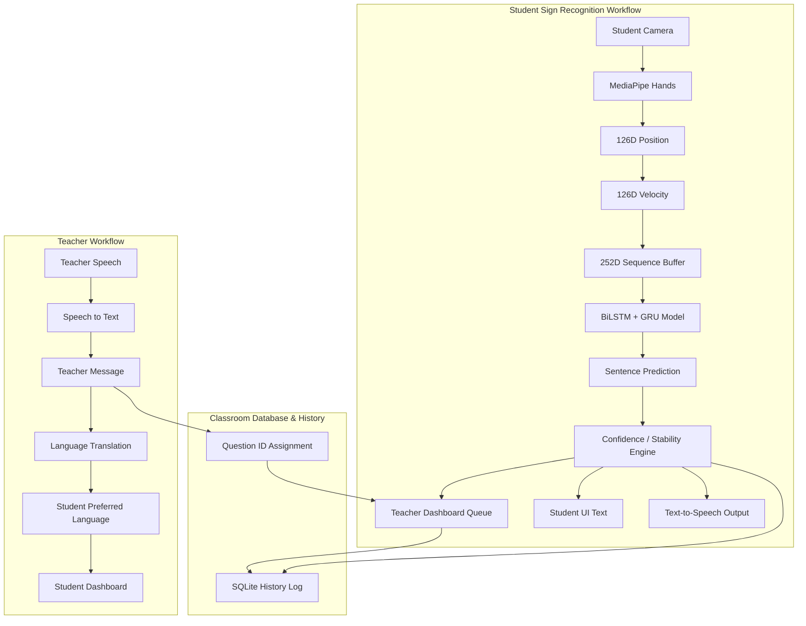

# SIGNBRIDGE

### AI-Powered Multilingual Inclusive Classroom Communication System

SIGNBRIDGE is an AI-based classroom communication platform designed to make teacher–student interaction easier when students use different languages or communicate through sign language.

---

## 1. Project Idea

In many classrooms, teachers and students may not share the same primary language, or students may have hearing and speech-related communication needs. SIGNBRIDGE provides a two-way communication channel between the teacher and students:

### Teacher Side
```
Teacher Speech 
  ➔ Speech-to-Text 
  ➔ Classroom Message 
  ➔ Student-Specific Language 
  ➔ Text / Voice on Student Screen
```

### Student Side
```
Student Speech OR Sign Language 
  ➔ AI Recognition 
  ➔ Text 
  ➔ Teacher Dashboard 
  ➔ Voice Output
```

Students can select their preferred instruction language when joining the classroom.

**Example Classroom Setup:**
* **Teacher:** Speaks in English
* **Student 1:** Receives instructions in Hindi
* **Student 2:** Receives instructions in Telugu
* **Student 3:** Receives instructions in English

A single speech input from the teacher is automatically presented on each student's screen according to their selected language preference.

---

## 2. Problem Statement

In a traditional classroom setting, communication obstacles arise when:
* The teacher and students speak different native languages.
* Students have hearing or speech impairments and rely on sign language.
* Teachers cannot repeat every explanation individually in multiple languages.
* Tracking responses from multiple students across different communication modes is difficult.

SIGNBRIDGE attempts to address these challenges through a unified classroom platform.

---

## 3. Key Features

### Teacher Dashboard
* Create a virtual classroom and generate a unique Room Code.
* Select the preferred teaching language (English, Hindi, or Telugu).
* Speak directly into the dashboard using built-in speech recognition.
* Broadcast questions and instructions to all joined students.
* View connected student list and their selected preferred languages.
* Receive real-time student responses (Text, Speech, or Sign Language).
* View prediction confidence scores for sign-language responses.
* Review question history linked by unique question IDs.
* Track overall classroom activity logs.

### Student Dashboard
* Join a classroom using a Room Code and Student Name.
* Select preferred instruction language (English, Hindi, or Telugu).
* Receive live teacher instructions in both text and voice.
* Choose between three response modes: **Sign Language**, **Speech**, or **Text**.
* Use a web camera for real-time sign recognition (ISL).
* View live predicted sign response and translation before submitting.
* Monitor confidence score and prediction stability.
* View personal activity and submission history.

### AI & Accessibility Module
* MediaPipe-based hand landmark extraction.
* 252D feature vector representation (126D Position + 126D Velocity).
* BiLSTM + GRU neural network for sequential sign recognition.
* Temporal frame buffer & prediction stabilization engine.
* Low-confidence threshold handling (prompts user when predictions are uncertain).
* Text-to-Speech (TTS) audio synthesis where browser support is available.

---

## 4. How the Sign Recognition Model Works

The sign recognition module converts video frames into predicted text sentences through six main steps:

```
[1. Video / Camera]
        │
        ▼
[2. MediaPipe Landmarks (126D Position)]
        │
        ▼
[3. Velocity Calculation (126D Velocity)]
        │
        ▼
[4. Feature Concatenation (252D Features)]
        │
        ▼
[5. Temporal Sequence Buffering (30 Frames × 252D)]
        │
        ▼
[6. BiLSTM + GRU Classification Network]
        │
        ▼
[Predicted Sentence Class]
```

* **Step 1 — Video / Camera:** The student's webcam captures a sequence of sign movements.
* **Step 2 — MediaPipe Detection:** MediaPipe extracts 21 3D landmarks ($x, y, z$) per hand. For 2 hands, this yields $21 \times 3 \times 2 = 126$ position values per frame.
* **Step 3 — Velocity Feature Extraction:** Velocity between consecutive frames is computed as:
  $$\text{Velocity}[t] = \text{Position}[t] - \text{Position}[t-1]$$
  This produces an additional 126 velocity values per frame.
* **Step 4 — Final Feature Representation:** Combining position and velocity vectors results in $126 + 126 = 252$ features per frame.
* **Step 5 — Temporal Sequence Buffering:** The model receives a fixed temporal window of 30 frames $\times$ 252 features per sequence.
* **Step 6 — Neural Network Classification:** A composite architecture comprising 1D Convolutional layers, Bidirectional LSTM layers, Bidirectional GRU layers, and Temporal Attention Pooling processes the 30-frame sequence and predicts the corresponding sentence class.

---

## 5. Feature Representation Experiment (Why 252D Was Selected)

To determine the most effective input representation for sign recognition, we conducted a controlled experiment comparing three feature configurations on the dataset:

| Representation | Feature Dimension | Test Accuracy | Top-5 Accuracy | Macro F1 |
|---|---:|---:|---:|---:|
| **Position Only** | 126D | 19.59% | 62.89% | 0.1512 |
| **Position + Velocity** | **252D** | **36.08%** | **70.10%** | **0.3203** |
| **Position + Velocity + Acceleration** | 378D | 27.84% | 65.98% | 0.2206 |

### Findings:
1. **Position (126D)** describes where hands are located in space, but misses movement dynamics.
2. **Position + Velocity (252D)** captures both hand placement and directional motion, yielding the highest accuracy and F1 score in our tests.
3. **Position + Velocity + Acceleration (378D)** introduced frame-to-frame noise in this dataset, which degraded overall performance.

Based on these measured results, **252D Position + Velocity** was selected for the final deployed model (`models/best_model_252.pth`).

---

## 6. Dataset Details

The dataset was compiled and preprocessed from video recordings of Indian Sign Language (ISL) sentence signs:

* **Original Videos Inspected:** 687
* **Verified Clean Samples:** 674
* **Active Sentence Classes:** 97
* **Sequence Length:** 30 frames per sample
* **Features per Frame:** 252 (126D position + 126D velocity)

### Preprocessing Pipeline:
* Landmark extraction via MediaPipe Hands.
* Wrist-relative spatial centering to normalize signer position.
* Scale normalization using hand span bounding box dimensions.
* Linear interpolation for missing hand landmark frames.
* Temporal padding / sampling to standardize all sequences to 30 frames.
* Training-only data augmentation (random rotation, scaling, and Gaussian jittering). Validation and test sets were kept strictly unaugmented.

---

## 7. Model Training & Configuration

The neural network was implemented in PyTorch and trained using the following configuration:

* **Framework:** PyTorch 2.0+
* **Architecture:** Conv1D + BiLSTM + BiGRU + Attention Pooling
* **Input Shape:** `(Batch_Size, 30, 252)`
* **Optimizer:** AdamW
* **Learning Rate:** 0.001 (with ReduceLROnPlateau scheduler)
* **Batch Size:** 16
* **Hidden Dimension:** 128
* **Dropout:** 0.3
* **Weight Decay:** 1e-4
* **Loss Function:** CrossEntropyLoss with Label Smoothing (0.1)
* **Early Stopping:** Patience of 15 epochs based on validation loss

---

## 8. Model Performance

Evaluated on the held-out test split, the final 252D model achieved:

* **Model Checkpoint:** `models/best_model_252.pth`
* **Test Top-1 Accuracy:** 36.08%
* **Test Top-5 Accuracy:** 70.10%
* **Macro F1 Score:** 0.3203
* **20-Video Unseen Signer Test:** 2 / 20 correct (10.0%)

> **Note on Performance:**  
> The current accuracy is suitable for a prototype demonstration. Because the original dataset contains a limited number of video recordings per sentence class, the model's ability to generalize to unseen signers remains limited. Expanding the training dataset with more signers is required for higher production accuracy.

---

## 9. System Architecture



---

## 10. Communication Flows

### Teacher ➔ Student Flow
1. Teacher sets the teaching language (e.g. English).
2. Teacher speaks an instruction into the microphone: *"Open your book"*.
3. Web Speech API transcribes the speech to text.
4. The translation engine converts the instruction into each student's selected preferred language (e.g., Hindi: *"अपनी किताब खोलें।"*, Telugu: *"మీ పుస్తకం తెరవండి"*).
5. The student dashboard displays the translated text and plays speech audio where browser TTS is supported.

### Student ➔ Teacher Flow
1. Student selects a response mode (**Sign Language**, **Speech**, or **Text**).
2. **In Sign Mode:** The camera captures 30 frames $\rightarrow$ MediaPipe extracts landmarks $\rightarrow$ 252D feature vector is formed $\rightarrow$ BiLSTM+GRU predicts the canonical sentence $\rightarrow$ Prediction is translated to Teacher Language $\rightarrow$ Result appears on Teacher Dashboard with audio playback.
3. **In Speech/Text Mode:** The student speaks or types in their preferred language $\rightarrow$ Translation engine converts text to Teacher Language $\rightarrow$ Result appears on Teacher Dashboard.

---

## 11. Question / Answer Tracking System

To keep classroom discussions structured:
1. Every instruction or question sent by a teacher generates a unique `question_id` (e.g. `q_1788026534822`).
2. All student responses are linked to that specific `question_id`.
3. The database stores:
   * `student_name`
   * `question_id`
   * `response_text`
   * `confidence_score`
   * `response_mode` (Sign, Speech, or Text)
   * `timestamp`
4. Teachers can review student answers grouped by question, and students can view their submission log.

---

## 12. Multilingual Support Status

### Currently Implemented & Tested
* **English (`en`)**
* **Hindi (`hi`)**
* **Telugu (`te`)**

### Planned Future Language Support
* **Santhali (`sat`)**
* **Ho (`hoc`)**
* **Mundari (`unr`)**

---

## 13. Accessibility Features

* **Visual Instruction Cards:** All spoken teacher instructions are displayed as readable high-contrast text cards.
* **Sign Language Pathway:** Non-speaking and deaf students can submit answers using Indian Sign Language.
* **Text Fallback for Audio:** If browser Text-to-Speech voice engines are unavailable, visual text remains visible with an explicit notice (`"Text available. Voice not available on this device."`).
* **Low-Confidence Notices:** If sign recognition confidence drops below threshold, the system displays `"Not confident. Please repeat the sign."` rather than sending inaccurate answers.

---

## 14. Project Structure

```text
SIGN_AI/
├── app.py                            # Main Flask & Socket.IO web server
├── requirements.txt                  # Python dependencies
├── render.yaml                       # Cloud deployment specification
├── Procfile                          # Gunicorn start script
├── models/
│   ├── best_model_252.pth            # Trained 252D BiLSTM+GRU model weights
│   ├── label_mapping.json            # 97 active sentence class index map
│   └── preprocessing_config.json     # Normalization and feature setup
├── src/
│   ├── model.py                      # PyTorch BiLSTM_GRU_Model definition
│   ├── realtime_engine.py            # Sequence buffering & inference logic
│   ├── translation_engine.py         # Vernacular translation & caching engine
│   ├── database.py                   # SQLite database & question log manager
│   ├── audit_and_diagnose.py         # System health & model diagnostic script
│   └── test_multilingual_system.py   # 14-test system verification suite
├── templates/
│   ├── create_room.html              # Teacher room setup page
│   ├── join_room.html                # Student room join page
│   ├── teacher_dashboard.html        # Teacher real-time dashboard
│   └── student_dashboard.html        # Accessible student classroom UI
├── static/
│   └── css/
│       └── classroom.css             # UI styling tokens and responsive layout
└── README.md                         # Project documentation
```

---

## 15. Setup & Local Execution

### Prerequisites
* Python 3.10+
* Google Chrome or modern WebRTC-compatible browser

### Installation
```bash
# 1. Clone repository
git clone https://github.com/Gireesh169/SIGN_AI.git
cd SIGN_AI

# 2. Create virtual environment & install dependencies
python3 -m venv venv
source venv/bin/activate
pip install -r requirements.txt

# 3. Run system diagnostics
python3 src/audit_and_diagnose.py

# 4. Run test suite
python3 src/test_multilingual_system.py

# 5. Launch application
python3 app.py
```

Open `http://localhost:5000` in your web browser.
