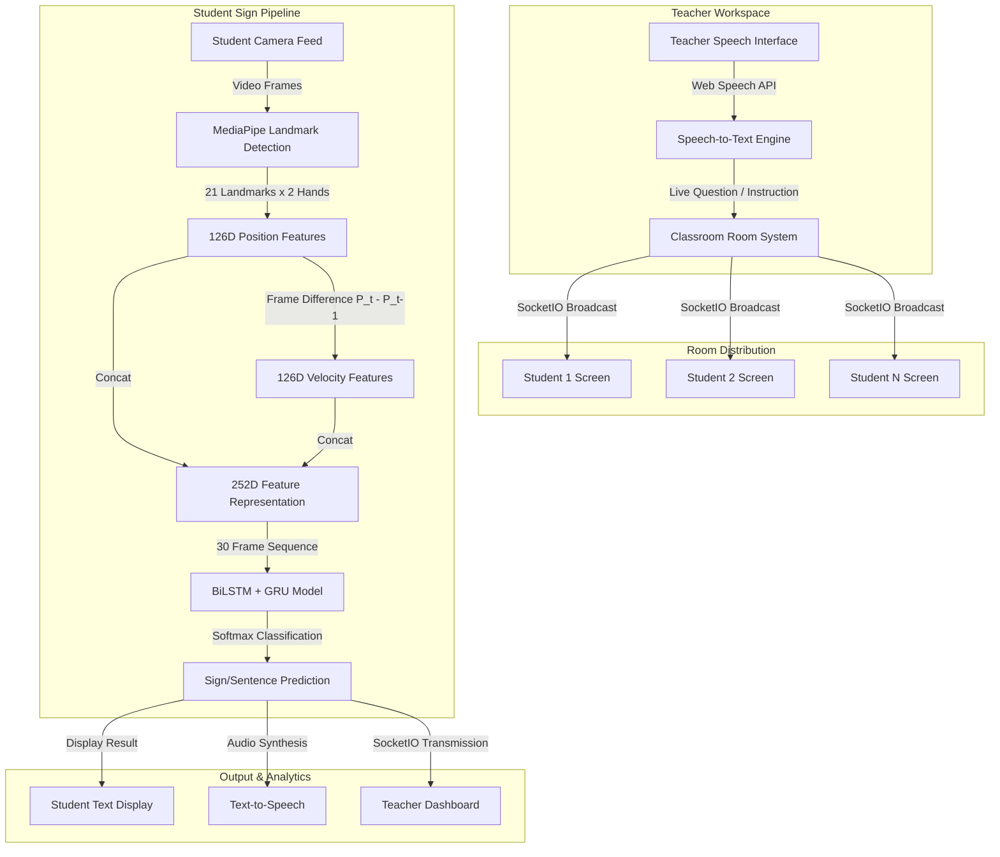

# SIGN-AI – AI-Powered Indian Sign Language Recognition and Inclusive Classroom Communication System

[](https://www.python.org/)
[](https://pytorch.org/)
[](https://google.github.io/mediapipe/)
[](https://flask.palletsprojects.com/)
[](LICENSE)

SIGN-AI is an artificial intelligence-driven communication and inclusive classroom platform built to bridge the communication gap between teachers and students who use Indian Sign Language (ISL). The platform facilitates continuous, interactive two-way communication in real-time within digital classrooms.

---

## 1. Project Overview

In traditional educational settings, students with hearing or speech impairments often face severe communication barriers when interacting with teachers and peers. SIGN-AI creates an inclusive learning environment by providing a seamless, real-time two-way communication bridge:

### Two-Way Communication Architecture

```
                                  TEACHER TO STUDENT
┌──────────────────┐    Speech-to-Text    ┌──────────────────────┐    SocketIO Broadcast    ┌───────────────────┐
│ Teacher Speaks   │ ───────────────────► │ Live Text Generation │ ───────────────────────► │ Student Dashboard │
└──────────────────┘                      └──────────────────────┘                          └───────────────────┘

                                  STUDENT TO TEACHER
┌──────────────────┐    MediaPipe & AI    ┌──────────────────────┐    SocketIO / REST       ┌───────────────────┐
│ Student Performs │ ───────────────────► │ Sign Sequence        │ ───────────────────────► │ Teacher Dashboard │
│ ISL Gesture      │                      │ Prediction (Text/TTS)│                          │ & Response Log    │
└──────────────────┘                      └──────────────────────┘                          └───────────────────┘
```

* **Teacher to Student Flow:**
  1. The teacher speaks into the microphone on the Teacher Dashboard.
  2. Live speech is transcribed into text using browser-native Speech Recognition (Web Speech API).
  3. The transcribed instruction or question is instantly broadcast to all connected students in the room via SocketIO.
  4. Students receive and display live instructions on their dashboards in real time.

* **Student to Teacher Flow:**
  1. A student captures their ISL response using their webcam.
  2. MediaPipe extracts 3D spatial hand landmarks from every frame.
  3. The custom **BiLSTM + GRU** neural network processes a 30-frame temporal sequence of **252D position and velocity features**.
  4. The predicted sentence and confidence score are rendered on the student UI.
  5. Built-in Text-to-Speech (TTS) synthesizes audio output.
  6. The response is transmitted directly to the Teacher Dashboard and saved in the classroom database.

---

## 2. Problem Statement

Students who communicate using Indian Sign Language (ISL) frequently experience isolation in conventional classrooms due to:
* A lack of real-time sign language interpreters.
* Difficulty following fast-paced spoken lectures.
* Inability to actively answer questions or communicate thoughts instantly to teachers.

**SIGN-AI** addresses these challenges by integrating:
* **Speech Recognition:** Transcribes teacher lectures into visible text.
* **Computer Vision & Hand Tracking:** Tracks subtle hand movements without requiring wearable hardware.
* **Deep Learning (BiLSTM + GRU):** Decodes multi-frame ISL temporal sequences into natural language text.
* **Real-Time Communication (WebSockets):** Synchronizes classroom interactions between teachers and multiple students simultaneously.

---

## 3. Key Features

### 👨‍🏫 Teacher Features
* **Create Classroom Room:** Easily generate virtual classrooms with custom room codes (e.g., `SIGN-XXXX`).
* **Multi-Student Support:** Connect multiple students concurrently to a single session.
* **Live Speech-to-Text:** Convert spoken lectures into written questions/instructions automatically.
* **Instruction Broadcasting:** Instant real-time push of instructions to all connected student screens.
* **Live Student Monitoring:** View connected students and track who has answered, who is typing, or who is currently signing.
* **Sign Response Reception:** Receive predicted ISL answers along with AI model confidence percentages.
* **Question History & Logs:** Detailed logs of asked questions, student answers, timestamps, and participation metrics.
* **Classroom Reports:** Exportable summary views of session participation and student responses.

### 👨‍🎓 Student Features
* **Join via Room ID:** Simple joining mechanism using the Room ID generated by the teacher.
* **Real-Time Instruction View:** Display incoming teacher instructions live on the dashboard.
* **Audio Playback (TTS):** Replay teacher instructions using text-to-speech for accessible auditory feedback.
* **Webcam Sign Detection:** Integrated camera interface for real-time sign language capture.
* **MediaPipe Hand Tracking:** Real-time extraction of 21 key points per hand (up to 42 points total).
* **AI-Powered Sign Prediction:** Real-time sentence/word recognition using the BiLSTM + GRU architecture.
* **Live Confidence Indicator:** Real-time display of prediction stability and confidence scores.
* **Text-to-Speech Output:** Speak out loud the detected ISL sentence upon confirmation.
* **Answer Submission:** Submit confirmed sign answers directly to the active teacher question.
* **Personal Activity History:** Review past answers, confidence history, and classroom interactions.

---

## 4. System Architecture



---

## 5. AI / Machine Learning Model

The core recognition pipeline belongs to the Deep Learning domain within Artificial Intelligence:

```
Artificial Intelligence
└── Machine Learning
    └── Deep Learning
        └── BiLSTM + GRU Recurrent Neural Network
```

### Selected Model Architecture

* **MediaPipe Landmark Extraction:** Extracts 3D positions ($x, y, z$) for 21 left-hand landmarks and 21 right-hand landmarks ($42 \text{ points} \times 3 = 126 \text{ coordinates}$).
* **Position Features:** 126-dimensional spatial vector $P[t]$ per frame.
* **Velocity Features:** 126-dimensional temporal change vector $V[t] = P[t] - P[t-1]$.
* **252-Dimensional Feature Vector:** Position ($126D$) + Velocity ($126D$) concatenated into a $252D$ feature vector per frame.
* **30-Frame Temporal Sequence:** Each sign gesture is uniformly sampled to a fixed sequence length of 30 frames ($30 \times 252$).
* **1D Temporal Convolution (Conv1d):** Maps 252 input features to 32 hidden feature dimensions with BatchNorm and SiLU activation.
* **BiLSTM:** Bidirectional Long Short-Term Memory layer captures forward and backward temporal context.
* **GRU:** Bidirectional Gated Recurrent Unit layer refines complex sequence representations.
* **Temporal Attention & Mean Pooling:** Softmax Temporal Attention weights key temporal frames, combined with global average pooling.
* **Classification Layer:** Dense classification head with dropout mapping to 97 active sentence classes.

### Feature Representation Breakdown
* **Position Features ($P[t]$):** 126 dimensions
* **Velocity Features ($V[t]$):** 126 dimensions
* **Final Model Input Shape:** $30 \times 252$

### Velocity Calculation Formula
$$V[t] = P[t] - P[t-1] \quad \text{for } t > 0, \quad V[0] = 0$$

### Why Position + Velocity Was Selected
1. **Dynamic Gesture Trajectory:** Position captures static hand shape/configuration, whereas velocity captures direction, speed, and motion trajectories.
2. **Positional Invariance:** Velocity features reduce sensitivity to absolute hand placement variations in front of the camera.
3. **Smooth Transitions:** Helps the model distinguish gestures that share similar static hand shapes but differ in movement direction.

---

## 6. Model Experiments

To identify the optimal feature representation, three distinct experiments were evaluated under identical training conditions:

| Experiment | Feature Representation | Test Accuracy | Top-5 Accuracy | Macro F1 |
| :--- | :--- | :--- | :--- | :--- |
| **Model A** | 126D Position | 19.59% | 62.89% | 0.1512 |
| **Model B** | **252D Position + Velocity** | **36.08%** | **70.10%** | **0.3203** |
| **Model C** | 378D Position + Velocity + Acceleration | 27.84% | 65.98% | 0.2206 |

### Verified Experiment Benchmarks

* **Winning Model:** **252D Position + Velocity**
* **Final Test Accuracy:** **36.08%**
* **Top-5 Accuracy:** **70.10%**
* **Macro F1:** **0.3203**

### Explanation of Results
Adding 2nd-order derivative features (acceleration in Model C, 378D) introduced high-frequency noise caused by discrete frame differentiation over minor hand landmark jitters. This increased input dimensionality without adding clean signal, resulting in a performance degradation compared to the **252D Position + Velocity** representation.

---

## 7. Dataset

The dataset was constructed and audited from the ISL-CSLRT corpus and verified video captures:

* **Total Verified Samples:** 674 clean, recoverable video sequences
* **Active Classes:** 97 distinct ISL sentence classes
* **Sequence Length:** 30 uniformly sampled frames per sample
* **Landmark Feature Dimensions:** 126 dimensions (Position)
* **Final Enhanced Feature Vector:** 252 dimensions (**Position + Velocity**)
* **Corrupted / Unrecoverable Videos:** Screened out during dataset audit (`dataset_audit.py`)
* **Low-Sample Handling:** Class balancing performed via temporal frame interpolation and coordinate jitter augmentation during training

> **Notice:** The dataset contains 674 verified samples across 97 sentence classes (~7 samples per class). This sample size is designed for research baseline evaluation and is not sufficient for production-level accuracy in unconstrained settings.

---

## 8. Data Preprocessing

The data preprocessing pipeline includes the following stages:

1. **Video/Frame Decoding:** Videos are decoded using OpenCV VideoCapture with ImageIO fallback.
2. **Uniform Frame Resampling:** Sequences are interpolated or uniformly sampled to exactly **30 frames**.
3. **MediaPipe Hand Landmark Detection:** Tracks up to 2 hands (21 3D keypoints per hand). Missing hands are padded with 63 zeros.
4. **Wrist-Relative Centering:** Hand coordinates are normalized relative to the wrist landmark ($X_{rel} = X - X_{wrist}$, $Y_{rel} = Y - Y_{wrist}$).
5. **Palm Scale Normalization:** Coordinates are scaled by the Euclidean distance between the wrist and middle finger MCP joint.
6. **Position Feature Vector:** Extracted 126D spatial position vector $P[t]$.
7. **Velocity Calculation:** $V[t] = P[t] - P[t-1]$ computed across consecutive frames.
8. **252D Sequence Tensor:** Position and velocity vectors are concatenated into a $(30, 252)$ feature tensor.

### Data Augmentation & Data Leakage Prevention
* Data augmentation (Gaussian landmark noise $\sigma=0.005$, spatial translation $\pm 5\%$, temporal frame dropout $10\%$) was applied **only to the training set split**.
* Validation and test sets were held out without augmentation to prevent data leakage.

---

## 9. Classroom Communication Flow

### Teacher to Student Flow
1. Teacher creates a room on the dashboard.
2. Students join using the generated Room ID.
3. Teacher speaks an instruction or question.
4. Speech is converted into text via the Web Speech API.
5. The instruction is broadcast live to all students in the room via SocketIO.
6. Students read the instruction on their screen.
7. Students can optionally click to listen to the instruction using Text-to-Speech.

### Student to Teacher Flow
1. Student receives the teacher's question.
2. Student performs the corresponding Indian Sign Language gesture.
3. Camera captures the sign sequence.
4. MediaPipe extracts spatial hand landmarks.
5. Position ($126D$) and velocity ($126D$) features are generated ($252D$).
6. A 30-frame sequence tensor is assembled.
7. The BiLSTM + GRU deep learning model predicts the sign/sentence.
8. Prediction confidence and temporal stability are verified.
9. The stable predicted sentence is displayed to the student.
10. Text-to-Speech generates spoken audio output.
11. The answer is transmitted to the Teacher Dashboard and logged in the database.

---

## 10. Question and Answer Logging

SIGN-AI maintains a comprehensive classroom activity system backed by an SQLite database (`data/inclusive_classroom.db`).

### Teacher Question Attributes
* **Question ID:** Unique identifier for every broadcast question
* **Room ID:** Virtual classroom code
* **Question Text:** Spoken/transcribed teacher instruction
* **Timestamp:** Exact broadcast time

### Student Answer Attributes
* **Student Name:** Name of responding student
* **Predicted Answer:** AI-recognized ISL sentence
* **Confidence:** Model prediction confidence score
* **Status:** Current status (`ANSWERED`, `PENDING`, `TYPING`)
* **Timestamp:** Time of response submission
* **Associated Question ID:** Question being answered

### Example Classroom Log View

```text
Teacher Question [ID: 201]: "How are you?"

Student Responses:
  ├── Gireesh    — "I am fine" — 82% confidence — ANSWERED [10:14:02]
  ├── Student A  — "I am good" — 75% confidence — ANSWERED [10:14:15]
  └── Student B  — Waiting...                 — PENDING
```

Students can also access their personal activity history on the Student Dashboard to review previous questions and their submitted sign responses.

---

## 11. Project Structure

```
SIGN-AI/
│
├── app.py                         # Flask application with SocketIO events & REST endpoints
├── requirements.txt               # Required Python packages
├── package-lock.json              # Frontend package lock file
├── README.md                      # Complete project documentation
│
├── src/                           # Source code modules
│   ├── config.py                  # Directory configuration, constants, and hyperparameters
│   ├── database.py                # SQLite database operations for rooms, questions, and logs
│   ├── feature_extraction.py      # MediaPipe landmark extraction & normalization module
│   ├── model.py                   # BiLSTM + GRU model definition with temporal attention
│   ├── realtime_engine.py         # Real-time frame processing & prediction buffer engine
│   ├── train.py                   # PyTorch training script with validation & checkpointing
│   ├── video_inference.py         # Offline video file inference script
│   ├── webcam_inference.py        # Standalone webcam inference testing tool
│   ├── conversation_memory.py     # Classroom dialogue memory store
│   ├── build_final_97_dataset.py  # Dataset compilation script for 97 classes
│   └── run_velocity_experiments.py# Script for running 126D vs 252D vs 378D benchmark experiments
│
├── models/                        # Model weights and evaluation metrics
│   ├── best_model_252.pth         # Winning 252D BiLSTM + GRU model weights file
│   ├── best_model_126.pth         # 126D Position baseline model weights file
│   ├── best_model_378.pth         # 378D Acceleration baseline model weights file
│   ├── label_mapping.json         # JSON mapping of class indices to 97 ISL sentence labels
│   ├── velocity_experiment_metrics.json # Performance metrics JSON for all model experiments
│   ├── confusion_matrix.png       # Test set confusion matrix visualization
│   └── training_history.png       # Training/validation loss and accuracy plot
│
├── data/                          # Processed dataset files & SQLite database
│   ├── X_features_97.npy          # Processed 252D features array (674, 30, 252)
│   ├── y_labels_97.npy            # Processed label index array
│   ├── label_mapping_97.json      # Class label mapping file
│   └── inclusive_classroom.db     # SQLite classroom database
│
├── static/                        # Static assets (CSS, JS, media uploads)
│   ├── css/                       # Custom CSS stylesheets for classroom pages
│   ├── js/                        # Client-side JavaScript (SocketIO, speech recognition, camera)
│   └── uploads/                   # Temporary file uploads directory
│
├── templates/                     # Jinja2 HTML templates
│   ├── index.html                 # Main platform landing page
│   ├── create_room.html           # Room creation page for teachers
│   ├── join_room.html             # Room joining page for students
│   ├── teacher_dashboard.html     # Teacher dashboard template
│   ├── student_dashboard.html     # Student classroom dashboard template
│   ├── history.html               # Session history log template
│   └── report.html                # Classroom session report template
│
├── ISL_CSLRT_Corpus/              # Original ISL video corpus dataset
└── results/                       # Output logs, metrics reports, and benchmark charts
```

---

## 12. Installation

### Step 1: Clone Repository
```bash
git clone https://github.com/Gireesh169/SIGN_AI.git
cd SIGN_AI
```

### Step 2: Create Virtual Environment
```bash
python3 -m venv venv
```

### Step 3: Activate Virtual Environment
```bash
# macOS / Linux
source venv/bin/activate

# Windows (Command Prompt)
venv\Scripts\activate
```

### Step 4: Install Dependencies
```bash
pip install -r requirements.txt
```

### Step 5: Verify Model Files
Check that `best_model_252.pth` and `label_mapping.json` exist in the `models/` directory:
```bash
ls models/best_model_252.pth models/label_mapping.json
```

### Step 6: Run the Backend Server
```bash
python app.py
```

### Step 7: Open the Application
Open your browser and navigate to:
```text
http://127.0.0.1:5001
```

---

## 13. Requirements

### Backend
* `flask>=2.2.0`
* `flask-socketio>=5.3.0`
* `eventlet`

### AI / Machine Learning
* `torch>=2.0.0`
* `scikit-learn>=1.2.0`
* `numpy>=1.24.0`

### Media Processing
* `mediapipe>=0.10.0`
* `opencv-python>=4.8.0`
* `imageio>=2.30.0`
* `imageio-ffmpeg>=0.4.8`

### Frontend & Utilities
* `pyttsx3>=2.90`
* `gtts>=2.3.0`
* `matplotlib>=3.7.0`
* `tqdm>=4.65.0`
* Web Speech API (Browser Native)

---

## 14. How to Use

### Teacher
1. Open the Teacher Dashboard at `http://127.0.0.1:5001/create-room`.
2. Enter teacher name, subject, and room name, then click **Create Room**.
3. Share the generated **Room ID** with students.
4. Wait for students to join the classroom.
5. Ask a question using voice speech input or typing.
6. Click **Broadcast Question** to send it live to students.
7. Monitor incoming student sign responses in real time.
8. Open **Question History / Reports** to review student responses.

### Student
1. Open the Student Classroom at `http://127.0.0.1:5001/join-room`.
2. Enter the **Room ID** provided by the teacher and student name.
3. Click **Join Room**.
4. Read or listen (via Text-to-Speech) to teacher instructions.
5. Click **Enable Camera** to start hand tracking.
6. Perform the sign gesture clearly within camera view.
7. Wait for AI sign detection to output the predicted sentence and confidence.
8. Verify the detected response.
9. Click **Submit Answer** to send it to the teacher dashboard.
10. View personal activity history.

---

## 15. Model Performance and Limitations

### Empirical Model Performance
* **Winning Architecture:** 252D Position + Velocity BiLSTM + GRU
* **Final Test Accuracy (Top-1):** **36.08%**
* **Top-5 Accuracy:** **70.10%**
* **Macro F1 Score:** **0.3203**

### Technical Limitations
* **Limited Dataset Size:** The dataset contains 674 total samples across 97 sentence classes (~7 samples per class).
* **Gesture Similarity:** Classes with subtle hand movement variations may produce overlapping feature trajectories.
* **Environmental Noise:** Recognition accuracy can be impacted by:
  * Dim or uneven room lighting
  * Extreme camera angles or distance from camera
  * Hand occlusion or hand leaving camera frame
  * Complex or moving background clutter
  * Individual signer variations
  * MediaPipe tracking failures on low-contrast hand positions

> **Note:** The project provides an experimental framework and baseline demonstration. It is not currently claimed to be production-ready.

---

## 16. Future Improvements

Future development plans include:

* Larger and more diverse ISL dataset with more signers
* Increasing sample count per class to 50+ sequences
* Incorporating upper-body pose landmarks (MediaPipe Pose)
* Incorporating facial landmark dynamics (MediaPipe Face Mesh)
* Multimodal fusion (Hand + Pose + Face)
* Better multi-person hand isolation and signer tracking
* ROI visual feature extraction using visual CNN embeddings
* Sentence structure correction using context-aware language models
* Mobile application development (iOS / Android)
* Cloud deployment and containerization (Docker)
* Automated attendance tracking and student participation analytics

---

## 17. Technology Stack

| Category | Technology | Purpose |
| :--- | :--- | :--- |
| **Backend Language** | Python 3.9+ | Main application logic and AI execution |
| **Deep Learning** | PyTorch | Model architecture, training, and tensor operations |
| **Hand Tracking** | MediaPipe | Extracting 21 3D hand keypoints per hand |
| **Computer Vision** | OpenCV | Camera frame capture and image processing |
| **Web Server** | Flask & Flask-SocketIO | Web app routes and real-time WebSocket communication |
| **Database** | SQLite3 | Database for rooms, questions, and responses |
| **Frontend** | HTML, CSS, JavaScript | Interactive user interface and webcam handling |
| **Speech Engine** | Web Speech API & pyttsx3 | Speech-to-text input and text-to-speech output |

---

## 18. Screenshots

### Landing Page


### Room Creation


### Teacher Dashboard


### Student Classroom


### Live Teacher Instruction


### Student Sign Detection


### Teacher Response Log


### Student Activity History


---

## 19. API Documentation

### REST API Endpoints

#### 1. Create Room Endpoint
* **Method:** `POST`
* **Endpoint:** `/api/create_room`
* **Purpose:** Creates a new virtual classroom room.
* **Request Body (Form Data):**
  * `teacher_name`: String
  * `room_name`: String
  * `subject`: String
  * `max_students`: Integer
* **Response:** Redirects to `/teacher/<room_code>`

#### 2. Real-Time Prediction Endpoint
* **Method:** `POST`
* **Endpoint:** `/predict`
* **Purpose:** Performs AI sign prediction on an incoming camera frame.
* **Request Body (JSON):**
  ```json
  {
    "image": "data:image/jpeg;base64,/9j/4AAQSkZJRg..."
  }
  ```
* **Response Example:**
  ```json
  {
    "status": "success",
    "predicted_text": "i am sitting in the class",
    "confidence": 0.823,
    "stable": true,
    "uncertain": false,
    "top_predictions": [
      {"class": "i am sitting in the class", "confidence": 0.823},
      {"class": "what are you doing", "confidence": 0.081}
    ],
    "fps": 28.5
  }
  ```

#### 3. Question Responses Endpoint
* **Method:** `GET`
* **Endpoint:** `/api/question_responses/<question_id>`
* **Purpose:** Fetches all student answers for a specific question ID.
* **Response Example:**
  ```json
  {
    "responses": [
      {
        "student_name": "Gireesh",
        "answer": "i am sitting in the class",
        "confidence": 0.823,
        "status": "ANSWERED",
        "timestamp": "2026-08-23 10:14:02"
      }
    ]
  }
  ```

---

## 20. Contributing

Contributions are welcome! To contribute:

1. Fork the repository.
2. Create a new feature branch (`git checkout -b feature/NewFeature`).
3. Commit your changes (`git commit -m 'Add NewFeature'`).
4. Push to the branch (`git push origin feature/NewFeature`).
5. Open a Pull Request.

---

## 21. Team / Author

Developed by: **Gireesh and Team**

Project: SIGN-AI – AI-Powered Indian Sign Language Recognition and Inclusive Classroom Communication System
Repository: [https://github.com/Gireesh169/SIGN_AI](https://github.com/Gireesh169/SIGN_AI)
